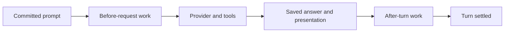

> Historical reference only. Snapshot of `docs/developer/extension-event-jobs.md` at `10b9dd66d06ef28718b58530a7e5b01c7c50397a` on 2026-10-18.
> Original body retained; relative links rebased for this archive.
> Use the [current manual](../../../../developer/extension-event-jobs.md).

# Event jobs and context recall

Event jobs let selected extensions propose normal host actions in response to
committed prompt or completed-answer facts. They use a distinct `event.job` capability and typed job
exports. [Read-only notifications](extension-events.md) retain their exact
acknowledgment contract; enabling them does not authorize actions or model calls.
See [operator procedures](../operator/extensions.md#event-jobs) for selection.

## Declarations and handlers

A job subscription uses the common prompt event/view/version fields plus a
handler ID and schedule. For example, inside a complete reviewed manifest:

```json
{
  "capabilities": ["event.job", "event.prompt.effective", "host.actions", "host.state.read", "host.context"],
  "subscriptions": [
    {
      "id": "recall",
      "event": "prompt.effective_committed",
      "event_version": 1,
      "view": "prompt.effective",
      "mode": "job",
      "handler": "recall",
      "schedule": "before_request",
      "required": true
    }
  ],
  "exports": {
    "version": 1,
    "tools": [],
    "commands": [],
    "services": [],
    "jobs": [
      {
        "id": "recall",
        "description": "Recall selected scoped evidence",
        "arguments_schema": {
          "type": "object",
          "additionalProperties": false,
          "required": ["event"],
          "properties": {"event": {"type": "object"}}
        },
        "result_schema": {
          "type": "object",
          "additionalProperties": false,
          "required": ["status"],
          "properties": {"status": {"type": "string", "enum": ["ok"]}}
        }
      }
    ]
  }
}
```

`jobs` is an optional version-1 export group. Omission/empty means no job exports;
legacy empty export helpers and digests keep their original meaning. Each job
descriptor uses the existing inert invocation argument/result schemas. A declared
handler must exist in the same artifact's job exports. These descriptors consume
the ordinary eight-per-group/32-total catalog bounds; selected subscriptions
retain their four-per-artifact/eight-total bounds. `describe/0` must match the
reviewed exports, capabilities and subscriptions.

Only `before_request` and `after_turn` schedules are accepted. Read-only `notify`
prompt declarations keep their original six-field schema and before-request timing.
`answer.committed` jobs and notifications require `after_turn`; private original
and presented answer views require their separate `event.answer.*` capabilities.
An artifact with both modes declares both capabilities. Private original/effective
views still need their respective read grants; every requested host operation
also needs `host.actions` and its own operation capability. Import/inspection,
compatibility checks and disabled selection execute no handler.

Job handlers are not model tools or operator commands. They do not appear in
provider tool definitions, and `Session.invoke_export/4` cannot invoke the job
stage. An extension may separately export ordinary tools/commands for explicit
use, such as recall/forget; their normal approvals remain independent.

## Execution and provenance

Session syncs the source-bound event delivery intent, validates the job's complete
callback arguments, then syncs an ordinary invocation intent before executable
startup. The callback is `handle("event.job", payload, state)`. Its payload uses
the standard invocation IDs/session/turn/handler/arguments fields:

- `arguments.event` contains the common selected event-delivery envelope.
- Top-level `trigger` is host-created: `kind: "event"`, delivery ID, source event
  ID and schedule. An argument claiming the same keys is not host provenance.
- The private journal parent also binds the delivery-intent digest and both
  captured prompt source references. Answer-triggered parents additionally bind
  the exact answer source; legacy prompt triggers retain their two-source shape.
  Those private hashes/references are not
  forwarded through the public trigger, including to metadata-only jobs.

The source/identity/handler/turn/arguments links are validated on restore. Session,
saved diagnostics and handoff export also resolve physical source positions
against the actual journal before repair or further work. A valid-looking source
object alone is not an authenticated host fact.

A job returns the ordinary schema-checked `result` value or a finite `host_call`
proposal. The existing invocation/action runner owns execution: journal intent,
validate current lease/schema/scope, ask for full mutation approval, execute
outside Session, then commit the bounded outcome. Selection, an event, a prior
tool approval or a clarification answer cannot approve a new write. Headless
mutation remains denied without explicit enabling. A separately trusted
[`host.model`](extension-model-calls.md) operation supplies explicit one-shot text
inference with its own profile, egress approval, canonical usage and shared budget.
Metadata notification alone grants no prompt/history access or model authority;
embeddings remain unsupported.

No resource is shared with a read-only text consumer or another callback VM.
Worker initialization/callback deadlines, 16 KiB SDK objects, 8 KiB strings and
16-action invocation limits remain in force. Jobs share the 10,000-invocation
session ceiling and the separate 10,000-delivery ceiling. There is one owned
effectful lane, not arbitrary concurrent or recursively launched turns.

## Before requests and after answers



Before-request jobs run at the post-transform prompt boundary, before MCP
discovery, compaction and inference for that input. An awaited recall job can
read scoped state or call a bound value service, then use `context.publish`.
Accepted contributions are frozen in the normal main-request context snapshot;
retrieval data remains attributed, bounded untrusted evidence.

After-turn jobs begin only after the answer/presentation is saved and a
`lifecycle_turn_settling` fact binds that final state. They cannot change the
already admitted provider request or retract streamed output. A context
publication at this stage is eligible only at a later request boundary. These
jobs use the same serial owned lane; the session stays busy until maintenance
settles, and an approval/question may wait for the operator. Fully concurrent
background jobs and live activation remain separate negotiated enhancements.

The host computes delivery outcome from committed action receipts, not a handler's
business claims. With a valid final response and confirmed cleanup, all actions
must be `ok`/`answered` for `completed`; denied, conflicting, failed or cancelled
actions produce `failed`. A callback claiming success cannot change those facts.
Pure jobs with no actions can complete, but their returned values remain
extension assertions, not proof of a storage or network effect.

At job completion, required failure stops later declarations; before-request
failure stops inference. During a continuation the callback can inspect known
failed actions and propose further separately admitted actions under the ordinary
finite runner contract.
After-turn failure cannot undo the answer or accounting already committed.
Optional known failure is reported and may continue. Any unknown job outcome
stops the lane even when optional: earlier effects may have occurred. A callback
or cleanup interruption is not relabeled `not_started`. Pre-execution schema/
budget refusal can record `not_started` without initializing a worker.

## Questions, cancellation and recovery

A job may request a normal structured operator question when that session permits
it. The worker closes before question publication. The checkpoint is bounded
JSON, not a VM heap. Explicit validated answers commit their action result and
continuation intent before a fresh worker enters `host.actions`; the original
event callback and earlier effects are not replayed. A subsequent write still
needs separate approval.

Pending-question restore retains the prompt source pair, the answer source when
applicable, current declaration, schedule
and remaining immutable plan. After-turn recovery also restores the saved final
answer. Completed earlier declarations are skipped, and the remaining plan runs
only as continuation of an explicitly answered question. Idle resume without a
pending question initializes no job and reconstructs no executable queue. A crash
after answer/continuation admission remains unknown until explicit recovery.

Cancellation/owner death stops dependent work under the existing OS cleanup
boundaries. Committed state/context remains; interrupted effects may be unknown
and are never automatically retried. Saved diagnostics count completed, failed,
unknown, not-started and incomplete deliveries without showing private inputs.
An unknown callback can leave cleanup unconfirmed even after its VM disappears.

For delayed indexing, capture a store revision/generation lease before asynchronous
extraction, retain it through checkpoints and use the same CAS precondition at
write. A fresh read after forget cannot authorize replay of an old captured fact.
Core tombstones and atomic revision checks provide the primitive; the memory
extension owns source cutoffs, suppression policy and derivative deletion. Source
IDs alone do not provide exactly-once writes or complete forgetting.

## Verification and remaining work

Independent-worker fixtures in `test/extensions_event_job_test.exs` exercise full
write approval/denial, source provenance, false success claims, awaited recall,
after-turn ordering and later context visibility, questions/resume in both
schedules, committed-write interruption with no idle replay, a captured-revision
write conflicting with concurrent forget, and metadata hash/native exclusion.
See [actual verification scope](testing.md#current-evidence-and-next-checks).

This is a generic host contract and synthetic coverage, not a production graph
engine. The separate [frozen-core installed lab](extension-proof.md) exercises
domain extraction, deduplication, catch-up, forget and receipt-backed recall.
The SDK offers
explicit [history pages](extension-history.md) and separately enrolled
[runtime epoch/wait facts](lifecycle-events.md#runtime-epochs-and-operator-waits).
Neither activates new job triggers or automatic catch-up. The
[coverage audit](lifecycle-events.md#supported-lifecycle-coverage) identifies exact
supported triggers. Production reindex policy remains separate domain work;
[accounted model calls](extension-model-calls.md) and shared admission use their
own host contracts. Optional
[diagnostic capture](observability.md) does not gate these jobs or their receipts.
