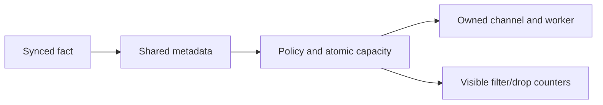

> Historical reference only. Snapshot of `docs/developer/observability.md` at `10b9dd66d06ef28718b58530a7e5b01c7c50397a` on 2026-10-18.
> Original body retained; relative links rebased for this archive.
> Use the [current manual](../../../2026-10-22-before-structural-consolidation/docs/developer/observability.md).

# Diagnostic capture and developer tracing

The implemented path projects committed journal facts into shared metadata,
then dispatches it through bounded owned sink workers. Capture defaults to off;
operator policy, selection and export capability are separate gates.
Separate [live lifecycle feeds](extension-feeds.md) use exact subscriptions and
durable acknowledgments with visible incomplete closure on pressure. Diagnostic
sampling/drop policy does not control them; separately granted tool-content views
remain private, and feed replies retain read-only authority.
[Operator procedures](../operator/observability.md) own configuration and stop.
The [synthetic conformance runner](extension-conformance.md) also supports
bounded local dispatcher tracing, independently of diagnostic sink selection. The
[dated proposal](../../../2026-10-17-observability-proposal/observability.md)
preserves the earlier design.

## Ownership and source identity

Session owns conversation, approvals, effects and the mandatory journal.
`Observability.Config` resolves operator-only policy; `Resources` owns leases and
receipts. Each `Channel` owns an independent worker, finite queue and counters.
`builtin:local-trace:1` is a default-off example using the ordinary worker SDK.



`Journal.append_observed/3` appends exactly once with an optional stable source.
Source overflow cannot lose/duplicate the recovery append; refused observations
are counted. Required prompt admission retains `append_with_source/3` and its
stricter bounds. Both require existing journal lock ownership. Off bypasses optional
projection work. `Lifecycle.Event.project/3` supplies the
[shared metadata envelope](lifecycle-events.md#internal-journal-source-and-prompt-views),
preserving source IDs and actual host correlation, without new random IDs per view
or guessed legacy links. Projection is not authentication or action authority.

Only new supported records written after enrollment are offered. Headers and old
records are not replayed. Enabled resume creates fresh leases; unfinished old ones
remain historical unknown, never reinitialized. Lease intent/ready/closed records
are mandatory recovery facts, independent of sample delivery.
The shared [runtime sources](lifecycle-events.md#runtime-epochs-and-operator-waits)
add a fresh session epoch and operator-wait starts/finishes. Capture enables their
recording, but an extension's separate `lifecycle.record` grant can enable them
with capture off. Stopping delivery does not stop an enrolled epoch's journal
sources. A logical close is committed after sink cleanup and need not reach that
sink; cleanup and journaling never depend on final notification acknowledgment.

## SDK contract

Artifacts declare exactly one of `observe.local` or `observe.export`, using normal
manifest/description, identity/options/runtime pins, operator trust and expiry.
No invocation export is needed. Import/inspection and mode `off` execute no sink
code. Export additionally needs an operator-scope instance; project configuration
cannot set capture policy.

Before startup, Session syncs `diagnostic_sink_intent`: fresh resource/session IDs,
exact activation identity, stage and complete bounded policy. Channel registers its
worker, initializes outside Session, then reports ready. Session syncs
`diagnostic_sink_ready` before drain. Samples during initialization use the same
finite capacity. Closure records cleanup confirmation and intent digest.

`handle("observe.local", payload, state)` or `observe.export` receives:

| Field | Value |
| --- | --- |
| `api_version` | Integer 1 |
| `handle` | Host resource ID, 32 lowercase hexadecimal characters |
| `event` | Wrapper: version 1, sequence, elapsed milliseconds, group, level and shared metadata `event` |
| `limits` | Host-pinned `file_bytes` and `retained_files` |

Sequence counts attempted observations in this capture epoch; unsupported,
filtered and dropped positions can create gaps. Elapsed time is monotonic since
epoch start, not an operation duration or wall clock. Request durations remain
separate facts. Completed assistant metadata uses group `stream`; compaction uses
`compaction`; both runtime epochs and operator waits use `session`. Wait duration
is measured only inside its recorded process epoch, never across restart.
Known group names do not imply sources for every proposed seam.

The only accepted response echoes actual values in a closed acknowledgment:

```elixir
%{"api_version" => 1, "kind" => "ack", "handle" => payload["handle"],
  "event_id" => payload["event"]["event"]["event_id"],
  "sequence" => payload["event"]["sequence"]}
```

Replies cannot transform prompts, publish context, approve tools, propose host
actions or infer. Initialization/callback deadlines are five seconds; ordinary
16 KiB SDK-object bounds apply. Wrapper validation accepts only known metadata,
fixed dimensions/counts and bounded host IDs; private hashes/text are refused.

## Bounds, stop and recovery

At most four channels coexist. Atomic capacity reservation precedes mailbox
admission; pending includes queued and in-flight callbacks. Configurable ceilings
are 256 samples per sink and 16 KiB per encoded sample. Sink IO/acknowledgment waits
run outside Session; mandatory journal sync retains its durability behavior.

Category/level/sampling rejection increments `filtered`; size/capacity rejection
and revoked pending work increment `dropped`. Errors bypass sampling/level, but
obey category/size/capacity; error counts remain visible on delivery failure.
Unsupported projections are separate counters. Invalid replies, crashes, timeout
or expiry stop that sink while agent work continues. Cleanup uncertainty remains
visible and can make explicit close fail; VM disappearance alone is insufficient.

`Session.stop_observability/1` revokes new admission immediately and discards pending
work. An in-flight callback may finish; existing transfers cannot be retracted.
Channel then closes its worker. Explicit close gives an idle active capture up to
500 ms to settle, then performs bounded parallel worker cleanup. This grace never
gates inference or action admission. Concurrent close paths share one cleanup result;
the worker publishes its actual native cleanup result into that lease before
exiting, including after callback failure or timeout. A later close can reuse that
confirmation; process death without a receipt remains unconfirmed.
Owner/channel death uses existing monitor/native ownership. No
diagnostic acknowledgment gates approvals, usage, effects or private subscriptions.

## Local ring retention

The local sink creates a private leaf under an existing canonical parent and
writes owner-only JSONL in `trace-ring-v1`. Backend option `retained_leases` is
1..32, default 4. This is extension behavior: event delivery, capture policy and
action APIs are unchanged. The callback's two-field `limits` stays intact; lease
count is pinned in instance options.

A persistent directory advisory lock serializes catalog admission and writes.
Each active worker also holds a slot lock for its lifetime. New workers choose the
next free slot in ring order, reset only its known data files, and atomically
publish its resource binding before appending. A full ring refuses new admission;
active writers are never evicted. Closure/owner death releases OS locks; lock files
remain in place to preserve inode identity.

Participants must match the catalog's file, rotation and lease limits exactly.
Filenames derive from bounded slot numbers, without an unbounded directory scan,
arbitrary path or foreign-file pruning. Each slot has at most two files of at most
10 MiB. Aggregate managed data is bounded by
`retained_leases × retained_files × file_bytes` (80 MiB by default). Catalog and
atomic-replacement scratch are each capped at 16 KiB, with at most the configured
number of zero-byte slot locks plus one directory lock. Reads, path types,
permissions, hardlinks, schema and policy are validated. Corruption/mismatch
refuses without repair or automatic limit migration. Reuse is retention, not an
age/TTL policy or a durable trace archive.

Abrupt owner death can interrupt the first catalog publication after directory or
scratch-file creation. An existing ring without a valid catalog refuses subsequent
capture just like other incomplete state; resume does not reconstruct or erase it.
This delivery failure is independent of whether the failed worker's OS cleanup
was confirmed. After reviewing the interrupted files, select a fresh directory
for a new session. Existing session identities remain pinned.

Legacy root-level lease logs and unrelated files are neither adopted nor deleted;
quota covers this managed format. Select a fresh directory for changed limits or
clean legacy files separately after review. Journals/source IDs remain intact when
trace slots are recycled. Capability checks do not restrict arbitrary worker OS
permissions.

The catalog reuses the strict bounded JSON decoder for syntax/duplicate keys.
Its valid slot keys, capacity and exact limits derive from pinned backend settings;
small map/range checks enforce that ownership policy without adding a general
validator runtime to sink workers. Native advisory locks reuse the OS helper.

## Lease recovery

Recovery validates declared identity, stage/capture authority, policy bounds,
intent hashes, receipt order/uniqueness and session binding before repair/work.
The 10,000-intent session ceiling refuses new leases without suppressing mandatory
work. Mode flags/environment are independent of the tool fingerprint; file edits
still participate in scoped-configuration source identity.

## Reuse and exporters

OTP atomics, monitors, tasks and filesystem IO plus existing Worker/Runner/Journal/
Source/JSON adapters suffice. No package or service is added. Finite admission,
privacy projection and independent receipts are harness policy, not a broker.
[Telemetry](https://telemetry.hexdocs.pm/telemetry.html) runs handlers in the caller,
provides no ordering guarantee and detaches failing handlers. Locked through
Finch/Plug, it is not promoted to a direct dependency and Ipse emits no application
Telemetry events. It cannot replace owned queues or action-bearing hooks.

For future OTLP export, evaluate maintained
[OpenTelemetry packages](https://opentelemetry.io/docs/languages/erlang/) behind
`observe.export`; inventory versions/licenses before adoption. Use explicit
endpoints, credential references and verified TLS, with no fallback or mandatory
collector. No OTLP adapter or live exporter is verified. Comparisons remain in
[runtime capabilities](runtime-capabilities.md).

## Developer diagnosis and remaining gates

Start with synthetic fixtures, `/diagnostics` and the metadata timeline:
`mix test test/observability_test.exs --trace` uses local workers without accounts
or collectors. Test output is not raw provider tracing. Never replay effects to
investigate failure.

Use the [conformance runner](extension-conformance.md) for synthetic callback,
question, action and context scenarios through the ordinary Session validators.
Choose dispatcher samples below for host scheduling evidence, or a development
source debugger for breakpoints and local variables. Neither diagnostic mode
changes approval, persistence or callback recovery policy.

### Synthetic dispatcher tracing

```sh
./bin/ipse extension check --config priv/conformance-operator.json --fixture priv/conformance-demo.json --extension annotation --no-project-config --developer-trace --trace-ms 1000 --trace-events 32
```

`Ipse.DeveloperTrace` creates an isolated
[OTP trace session](https://www.erlang.org/doc/apps/kernel/trace.html) for each
new synthetic Session. Only exported `Ipse.Session.handle_call/3` and
`handle_info/2` calls on that PID are eligible. The VM's `arity` flag excludes
arguments before collector admission; no message, return, exception, state or
stack trace is requested. Reports contain fixed module/function/arity, sample
sequence and relative monotonic microseconds. They contain no PID or content.
Worker VMs, provider bodies and arbitrary live sessions are outside this scope.
There is no user-supplied PID, wildcard, MFA or match specification.

The [match specification](https://www.erlang.org/doc/apps/erts/match_spec.html)
disables the target's call flag while emitting each sample. The collector re-arms
only after consuming it, so at most one VM-generated trace sample is pending;
this bounds emission rather than merely truncating a stored list. Calls while
disarmed are uncounted gaps. Reports always say `sampling: "one_in_flight"` and
`complete: false`; sequence counts captured samples, not all calls. It is not a
latency profiler, complete execution timeline or lossless knowledge feed.

Per-case bounds are 1..5000 ms and 1..128 stored samples, defaults 1000/32.
The collector checks the deadline before re-arming. An independent monitor-based
watchdog destroys the isolated trace session at the deadline or dependency death,
including when the collector is suspended. As with OTP timers, execution depends
on scheduler availability; this is not a hard realtime deadline. Collector/owner
death, target exit, explicit stop and conformance cancellation remove trace
settings. Watchdog loss also fails closed. Destruction does not affect other OTP
trace sessions. A stopped capture retains only its bounded report until the case
collects it or its owner dies; it does not keep tracing.

Normal stop/time/event limits are visible report reasons. The collector and
watchdog claim one shared closing reason before destroying settings, so a
simultaneous report request cannot replace a deadline outcome with `stopped`,
or mislabel a normal watchdog exit as failure. Missing capture, watchdog/trace
errors or unconfirmed cleanup make the conformance check fail.
Disabled tracing creates no collector or trace session. Flags apply only to
`extension check`, cannot be requested by fixtures and are independent of
`--observability`. OTP 27's session API is required; unavailable support refuses
instead of falling back to global legacy tracing. Extracted-package verification
exercises the actual CLI without a system toolchain.

### Source debugging

[ElixirLS DAP](https://elixir-lsp.github.io/elixir-ls/getting-started/vscode/)
already supports Mix task debugging and test-file loading through `requireFiles`.
Use that maintained adapter in a developer checkout with a focused synthetic test;
Ipse adds no editor plugin, debug server or separate source-debugger protocol.
The [OTP debugger](https://www.erlang.org/doc/apps/debugger/debugger_chapter.html)
uses interpreted modules and a GUI, so it is a development alternative rather
than a bundled CLI requirement. Breakpoints alter scheduling and may cause
ordinary worker deadlines to expire; those results cannot prove normal timing.

Local Serenity inspection found OTP 29.1.1's `debugger`, `int` and `wx` modules
and debug information in the development Session BEAM. This establishes module
availability only: no GUI/DAP session or editor breakpoint was exercised. The
matching extracted Linux release has `trace`, but no `debugger`, `int` or `wx`
modules and no Session debug-information chunk. Releases provide the narrow trace
CLI rather than a source-debugger environment or editor integration. No GUI/runtime
dependency is added; macOS availability requires its own package evidence.

Formatted status redaction does not protect
[`sys.get_state`](https://www.erlang.org/doc/apps/stdlib/sys.html#get_state/2)
or raw messages/arguments. Use synthetic inputs for breakpoints, and never suspend
a live Session while effects continue. No debugger listener or distributed node
is enabled. Committed runtime epoch/wait sources and negotiated private
[text-event identity](stream-events.md) are implemented. Diagnostics do not acquire
that private channel. The [independent lab](extension-proof.md) uses synthetic
`:sys.get_state/1` inspection solely to verify acknowledged ephemeral counters;
its domain workers receive no host PID or private state. The
[coverage audit](lifecycle-events.md#supported-lifecycle-coverage) defines current
private/causal seams; [P22 status](../plan.md#p22-extension-scaffold-and-lifecycle-hooks)
records passed hosted verification and the supported scope.

Diagnostic fixtures cover off parity, privacy/source identity, stop, export scope,
blocked/invalid sinks, owner-death VM/slot cleanup, rotation/aggregate bounds,
active-writer protection, mismatched limits, unsafe paths, legacy preservation,
filtering, historical resume and corruption. Cleanup regressions preserve native
receipts after callback failure and reproduce interrupted first-catalog state
without repairing it. [Testing](testing.md#current-evidence-and-next-checks)
distinguishes source, hosted and extracted evidence.
