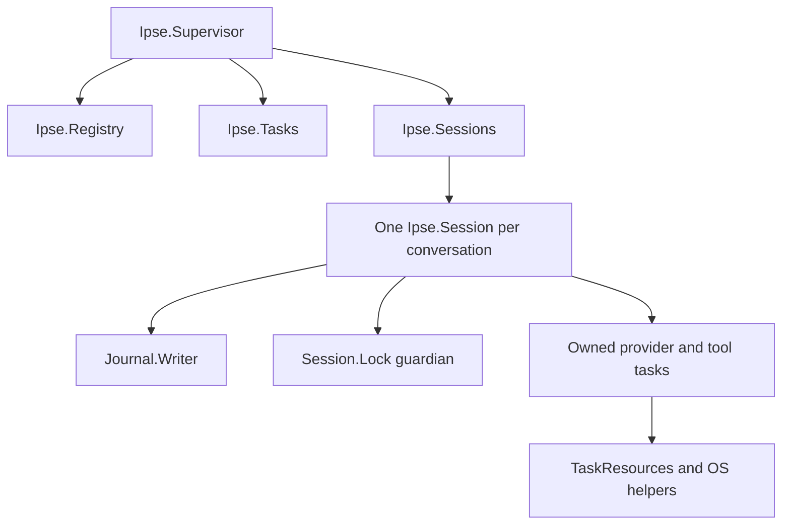

> Historical only. Preserved on 2026-10-22 from `5bffe00364d66f5012e5a0d4cd86c4180c74ebcb` before the structural/manual rewrite. Use [current guidance](https://github.com/lexlapax/ipse/blob/main/docs/developer/architecture.md). Relative prose links point to the original commit; commands and claims retain their original text.

# Follow a turn through Ipse

Ipse is an OTP application that owns a conversation, requests an answer from a
selected provider, and executes approved tool calls. Start here when you need to
change the turn loop or understand where a new feature belongs. You will follow
one request from the public Session API through persistence, provider work and
cleanup, then identify the tests that protect each boundary.

Read the [developer learning path](https://github.com/lexlapax/ipse/blob/5bffe00364d66f5012e5a0d4cd86c4180c74ebcb/docs/developer/index.md) for build prerequisites. Domain
features normally belong in [extensions](https://github.com/lexlapax/ipse/blob/5bffe00364d66f5012e5a0d4cd86c4180c74ebcb/docs/developer/extensions.md); change the host when the
requirement concerns authority, ownership, accounting or recovery shared by all
features.

## Run a session without an account

From a built checkout:

```sh
mix run examples/session/hello.exs
```

The [example](https://github.com/lexlapax/ipse/blob/5bffe00364d66f5012e5a0d4cd86c4180c74ebcb/examples/session/hello.exs) supplies a small provider module
that returns a fixed assistant message. It creates isolated temporary state,
submits a prompt, waits for completion, reads the saved journal and resumes the
session without requesting another answer. It removes its files afterward.
Expect:

```text
Session completed, journal retained its answer, and idle resume made no model call.
```

This is the shortest complete path through the harness. The provider is a fixture,
so the exercise uses no credentials, network model or billing. Change the returned
text and run it again before modifying the host.

## Find the owners

[`Ipse.Application`](https://github.com/lexlapax/ipse/blob/5bffe00364d66f5012e5a0d4cd86c4180c74ebcb/lib/ipse/application.ex) starts three shared services:
a unique Registry, a task supervisor and the Sessions dynamic supervisor. Session
children are temporary. A crashed conversation does not automatically restart and
replay its work.



The arrows describe supervision or resource ownership, not permission grants.
Session owns conversation messages, the current phase, approval/question state and
which task result it will accept. Slow provider, tool and extension IO runs outside
its GenServer. A task result carries identity that Session checks before advancing
the turn; a result arriving after cancellation cannot revive the cancelled job.

The writer owns the append descriptor. The lock guardian retains the native
advisory lock until tracked writers, workers, resource scopes and file effects
have stopped. `TaskResources` retains OS-helper receipts across task completion.
`FileEffect` fences an admitted filesystem critical section even if its caller
exits during IO. These processes solve different completion problems. Replacing
them with a task monitor alone would release ownership too early.

### Find extension code by its role

An extension calls the public SDK inside its worker. Host contracts admit those
calls and preserve approval, persistence and process ownership. Bundled behavior
uses that SDK too; its location reflects how Ipse distributes it.

| Role | Source | Change here when you need to |
| --- | --- | --- |
| Public worker SDK | `lib/ipse/extension.ex`, `lib/ipse/extension/` | Change callbacks, value validation or result publication |
| Generic host contracts | `lib/ipse/extensions/` | Admit and execute extension actions or manage workers |
| Bundled domain behavior | `lib/ipse/builtins/` | Change shipped Memory, reports, prompt annotation or answer formatting |
| Independent packages | `extensions/knowledge/` | Build Corpus, Graph or Research outside the host application |

For example, follow a note write from `Ipse.Builtins.Memory` into the generic
State action and Session's approval flow. The [memory exercise](https://github.com/lexlapax/ipse/blob/5bffe00364d66f5012e5a0d4cd86c4180c74ebcb/docs/developer/memory.md) traces
that complete continuation. Rate-card arithmetic belongs to `Ipse.Usage.Costs`;
the bundled reports obtain canonical records through the same host read contracts
available to an imported extension.

## Trace prompt admission

The public calls live at the top of
[`session.ex`](https://github.com/lexlapax/ipse/blob/5bffe00364d66f5012e5a0d4cd86c4180c74ebcb/lib/ipse/session.ex). In the example, the important pair is:

```elixir
:ok = Ipse.Session.prompt(session, "Say hello")

receive do
  {:ipse, ^session, {:done, :ok}} -> :ok
end
```

The first `:ok` means the prompt was accepted. It does not mean inference or tools
finished. Subscriber events arrive in `{:ipse, session_pid, event}` envelopes.
The terminal client in [`cli.ex`](https://github.com/lexlapax/ipse/blob/5bffe00364d66f5012e5a0d4cd86c4180c74ebcb/lib/ipse/cli.ex) translates those events
into display and user decisions.

Follow `handle_call({:prompt, text}, ...)` in Session. Admission rejects invalid or
oversized input, checks whether work is already active, records accepted input,
and starts the appropriate owned task. Workspace instructions and skills come
from the saved [workspace context](https://github.com/lexlapax/ipse/blob/5bffe00364d66f5012e5a0d4cd86c4180c74ebcb/docs/developer/workspace-context.md). They are untrusted
reference material, not action permission. The effective provider request is a
projection of retained conversation and context, rather than an arbitrary copy of
the entire journal.

For a change to input handling, distinguish four separate bounds: input bytes,
active context bytes, provider response limits and journal growth. Increasing one
does not increase the others. Use [compaction](https://github.com/lexlapax/ipse/blob/5bffe00364d66f5012e5a0d4cd86c4180c74ebcb/docs/developer/workspace-context.md#plan-a-reduction-at-the-model-boundary),
[provider limits](https://github.com/lexlapax/ipse/blob/5bffe00364d66f5012e5a0d4cd86c4180c74ebcb/docs/developer/provider-limits.md) and [persistence](https://github.com/lexlapax/ipse/blob/5bffe00364d66f5012e5a0d4cd86c4180c74ebcb/docs/developer/persistence.md) to choose
the correct boundary.

## Follow the provider result

[`Ipse.Provider`](https://github.com/lexlapax/ipse/blob/5bffe00364d66f5012e5a0d4cd86c4180c74ebcb/lib/ipse/provider.ex) selects the configured adapter.
Provider adapters translate wire responses into assistant messages, tool-call
proposals, visible stream events and usage facts. The `provider_module` hook used
by the example and Session tests replaces that transport for controlled fixtures.
It is not an operator configuration field or an automatic fallback provider.

Read the returned value in the example:

```elixir
{:ok,
 %{"role" => "assistant", "content" => "Hello from the session example."},
 %{}}
```

The assistant message is separate from usage metadata. Production adapters also
preserve provider-native continuation information. Do not render hidden reasoning
or discard required native data when changing the visible answer path. The
[private text stream](https://github.com/lexlapax/ipse/blob/5bffe00364d66f5012e5a0d4cd86c4180c74ebcb/docs/developer/text-streams.md) is a separate bounded delivery contract.

A provider may propose tools instead of a final answer. Session validates the
whole response before dispatch: malformed identities or an over-limit response
must not execute its first apparently valid call. Request usage and
[budget reservations](https://github.com/lexlapax/ipse/blob/5bffe00364d66f5012e5a0d4cd86c4180c74ebcb/docs/developer/budgets.md) survive later response or transport failures.
Provider errors never silently change endpoint, model, account or billing mode.

## Trace a tool and its approval

Use `writes wait for approval; denied actions remain in transcript` in
[`session_test.exs`](https://github.com/lexlapax/ipse/blob/5bffe00364d66f5012e5a0d4cd86c4180c74ebcb/test/session_test.exs) as the second reading exercise.
Its fixture provider proposes a real `write` call. The test receives the full
proposal, denies it and verifies that no file was created.

The sequence to preserve is:

1. Validate the call identity, arguments, workspace policy and applicable nested
   instructions before asking for approval or starting the effect.
2. Bind approval to that exact proposal. A question answer or skill instruction
   cannot grant mutation permission.
3. Journal admitted intent before execution. Run the effect in owned work.
4. Record its outcome and cleanup evidence before admitting dependent work.

`read` is ordinarily read-only; `write`, `edit`, `shell`, MCP and delegation have
explicit action rules. Interactive CLI approvals use a fresh displayed code.
Embedded clients call `Session.approve/3` with the received reference. Headless
mutation is denied without `--yes`. See [tool sources](https://github.com/lexlapax/ipse/blob/5bffe00364d66f5012e5a0d4cd86c4180c74ebcb/docs/developer/lifecycle-events.md#bind-admitted-tool-input-and-result) and
[workflow actions](https://github.com/lexlapax/ipse/blob/5bffe00364d66f5012e5a0d4cd86c4180c74ebcb/docs/developer/extension-effects.md#reuse-file-and-shell-ownership) before adding another tool path.

A failed setup known to precede execution can be `not_started`. Loss after an
effect might have begun is unknown. Never infer a definite failure merely because
the consumer died or a result was not recorded. That distinction determines
whether a user could safely request the action again.

## Understand completion and recovery

These are different facts:

| Observation | What it establishes |
| --- | --- |
| `prompt/2` returns `:ok` | Input was accepted |
| A subscriber receives `{:done, :ok}` | The turn reached its successful terminal state |
| A journal append succeeds | That record was durably accepted by the writer |
| A task exits | That BEAM process stopped |
| A native cleanup receipt succeeds | The helper confirmed its supported cleanup contract |
| `close_confirmed/1` succeeds | The owned Session acknowledged close and exited |

The example deliberately uses `close_confirmed/1`. Ordinary `close/1` can accept
an already-dead Session where an embedded owner requires the stronger
acknowledgment. Neither API converts missing helper evidence into proof that all
possible descendants stopped. In particular, deliberately detached macOS
children retain the [documented sandbox limits](https://github.com/lexlapax/ipse/blob/5bffe00364d66f5012e5a0d4cd86c4180c74ebcb/docs/developer/sandbox.md).

On resume, Session acquires ownership, loads and validates canonical records,
checks receipts and source links, then repairs only a permissible torn tail.
`Session.Saved` reconstructs pure facts after reload; Session retains recovery
that reads source pages and starts owned resources. The current invocation's
parent, pending action and recorded outcomes share `Session.Invocation`.
Session retains lifecycle phase, approval callers, timers and writer reservations.
It does not replay an interrupted tool, initialize an old unfinished callback or
ask the provider to continue while idle. Read the
[journal chapter](https://github.com/lexlapax/ipse/blob/5bffe00364d66f5012e5a0d4cd86c4180c74ebcb/docs/developer/persistence.md) before changing restore order.

## Choose the place for a change

| Requirement | Start reading |
| --- | --- |
| Add note retrieval, a report or a domain command | [Extension authoring](https://github.com/lexlapax/ipse/blob/5bffe00364d66f5012e5a0d4cd86c4180c74ebcb/docs/developer/extensions.md) |
| Add a provider setting or response field | [Profiles](https://github.com/lexlapax/ipse/blob/5bffe00364d66f5012e5a0d4cd86c4180c74ebcb/docs/developer/configuration.md#trace-main-and-child-profile-selection), [provider limits](https://github.com/lexlapax/ipse/blob/5bffe00364d66f5012e5a0d4cd86c4180c74ebcb/docs/developer/provider-limits.md) |
| Change shared approval or cancellation behavior | Session and its behavioral tests |
| Change file/process completion | `FileEffect`, `TaskResources`, `Session.Lock`, [native sandbox](https://github.com/lexlapax/ipse/blob/5bffe00364d66f5012e5a0d4cd86c4180c74ebcb/docs/developer/sandbox.md) |
| Change durable records or recovery | [Persistence](https://github.com/lexlapax/ipse/blob/5bffe00364d66f5012e5a0d4cd86c4180c74ebcb/docs/developer/persistence.md), [lifecycle sources](https://github.com/lexlapax/ipse/blob/5bffe00364d66f5012e5a0d4cd86c4180c74ebcb/docs/developer/lifecycle-events.md) |
| Decode bounded host JSON or preserve raw/canonical digests | `Ipse.JSON`, `test/json_test.exs`, [checkpoint identities](https://github.com/lexlapax/ipse/blob/5bffe00364d66f5012e5a0d4cd86c4180c74ebcb/docs/developer/workspace-context.md#commit-and-reconstruct-the-projection) |
| Add external tools | [MCP](https://github.com/lexlapax/ipse/blob/5bffe00364d66f5012e5a0d4cd86c4180c74ebcb/docs/developer/mcp.md), [dependency policy](https://github.com/lexlapax/ipse/blob/5bffe00364d66f5012e5a0d4cd86c4180c74ebcb/docs/developer/dependencies.md) |

Keep domain logic outside Session. Use existing OTP, schema, journal and helper
adapters before creating new protocol or validation machinery. Every new external
action needs an explicit owner, authority boundary and uncertain-outcome rule.

## Practice making a safe change

Add a second fixed response to the example provider, selected by an explicit
field in its fixture configuration. Observe where that field is read and where
messages become durable. Then extend a Session fixture to propose a write and
verify denial, approval and idle resume independently.

Run the closest behavioral checks first:

```sh
mix test test/session_test.exs test/question_session_test.exs
mix test test/tool_recovery_test.exs test/task_resources_test.exs
```

The first set exercises the conversation and user-decision boundary. The second
set exercises unknown effects and owned cleanup. They use synthetic providers
and temporary files. Follow the [verification guide](https://github.com/lexlapax/ipse/blob/5bffe00364d66f5012e5a0d4cd86c4180c74ebcb/docs/developer/testing.md) for the complete
handoff checks and OS-specific enforcement.
