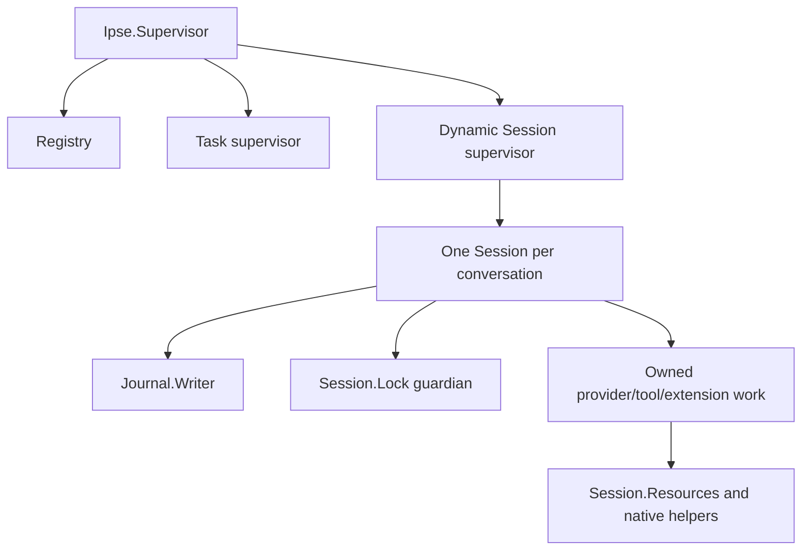

# Follow a turn through Ipse

Start with a complete conversation, then follow its admitted work into the owner
that can commit the result. Ipse keeps the agent loop, provider adapters, approvals,
persistence, and orchestration in Elixir/OTP. Small Rust helpers own OS facilities.
Optional domain behavior belongs in extensions unless it needs a generic host
guarantee. [Setup](index.md) provides the development prerequisites.

## Run the shortest complete conversation

From a built checkout:

```sh
mix run examples/session.exs
```

Read the [example](../../examples/session.exs) alongside its output. Its fixed
provider returns an assistant message without credentials or a model service.
The driver starts a Session in temporary state, prompts it, waits for completion,
reads the journal, closes the owner, and resumes idle. Expect:

```text
Session completed, journal retained its answer, and idle resume made no model call.
```

Change only the fixture response and run it again. Find the response in the
journal before cleanup. This connects the provider return value to durable
conversation state; returning text alone is not the complete host contract.

## Find the owners

[`Application`](../../lib/ipse/application.ex) starts a Registry, task supervisor,
and dynamic Session supervisor. Session children are temporary. A crash does not
automatically restart a conversation and replay its work.



These arrows show supervision or resource ownership, not permission. Session owns
the conversation, phase, pending decisions, and accepted task identity. Slow IO
runs outside its GenServer. The implementation is divided by responsibility:

| Read | Responsibility |
| --- | --- |
| [`Session`](../../lib/ipse/session.ex) | Public calls, caller/reference/phase admission, resources, accounting, cancellation, and authoritative state |
| [`Session.Turn`](../../lib/ipse/session/turn.ex) | Prompt preparation, request tool catalogs, model requests, native tools, questions, and turn transitions |
| [`Session.Invocation`](../../lib/ipse/session/invocation.ex) | Extension continuations, host calls, inference, and validated publication |
| [`Session.Context`](../../lib/ipse/session/context.ex) | System/header rendering, workspace/skill manifests, effective messages, compaction, runtime facts, and context measurement |
| [`Session.Saved`](../../lib/ipse/session/saved.ex) | Pure reconstruction plus validated inspection/handoff procedures |

Turn and Invocation are synchronous implementation modules in the same Session
process. They have no independent mailbox or conversation state. For worker
results, Session first matches the active task/ref/phase, closes its resource
scope, and records the applicable accounting. Only then does the matching
transition advance work. A stale result cannot revive a cancelled job.

Keep pure construction with its feature owner. Context renders model context;
Questions decides question availability; Delegation admits child routes and
budgets. Turn and Invocation call these modules directly. They call Session for
durable appends, accounting, approvals and resource registration because those
effects must change the conversation owner's authoritative state. Removing every
callback would hide that authority rather than simplify it.

The writer owns the append descriptor. The lock guardian waits for registered
writers, workers, scopes, and file effects before releasing the OS advisory lock.
`Session.Resources.file_effect/2` starts a separately tracked critical-section
process so filesystem IO can settle after caller death. A task monitor cannot
replace either that barrier or native cleanup evidence. See
[persistence](persistence.md) before changing close/recovery ordering.

## Trace prompt admission and the provider response

The example's central exchange is:

```elixir
:ok = Ipse.Session.prompt(session, "Say hello")
receive do
  {:ipse, ^session, {:done, :ok}} -> :ok
end
```

The return `:ok` means admission. The subscriber event means turn completion.
Follow Session's prompt handler into `Turn.prompt/3`. It bounds input and prepares
selected skills in registered owned work before retaining the accepted prompt.
Cancellation settles a pending prompt caller without admitting a partial message.
[`Workspace`](../../lib/ipse/workspace.ex) supplies saved instructions/skills.
Those documents are untrusted reference text, never authority for actions.

Context construction projects retained conversation and references into the next
provider request. Input, active context, provider response, and journal growth
have separate bounds. Changing one does not enlarge the others. Follow
[workspace context](workspace-context.md), [configuration](configuration.md),
and [persistence](persistence.md) when choosing which limit to change.

`Turn.launch_request` admits usage and budget liability before provider dispatch.
[`Provider.request_complete/4`](../../lib/ipse/provider.ex) resolves the selected
route and credentials, then calls its adapter. The example's `provider_module`
hook substitutes a controlled transport; it is not an operator configuration
field or fallback provider. Production OpenAI, Anthropic, and Ollama adapters
retain separate wire formats and provider continuation data.

A provider returns assistant data separately from usage metadata. Preserve native
continuation when changing visible text, and never render hidden reasoning.
[`Provider.Transport`](../../lib/ipse/provider/transport.ex) bounds response bytes,
deadlines, and sanitized errors; [`Provider.Stream`](../../lib/ipse/provider/stream.ex)
owns bounded line/SSE/fragment assembly. [`HTTP`](../../lib/ipse/http.ex) owns
private Finch clients and proxy policy across inference, auth, and MCP. A monitored
guardian keeps each bounded pool name until its client and descendants close.
[`Auth`](../../lib/ipse/auth.ex) owns public login, identity validation, protected
storage, and refresh locking. No failure silently changes billing or endpoint.

Visible streaming is a separate delivery contract from final answer admission.
A required consumer failure can prevent admission after text was already shown.
Usage and reservations survive later transport, framing, or response failures.
Read [lifecycle delivery](lifecycle-events.md) and [accounting](accounting.md)
before modifying this path.

## Trace a tool and its approval

Find the write-denial case in [`session_test.exs`](../../test/ipse/session_test.exs).
Its fixture proposes a real file write, receives the complete approval proposal,
denies it, and verifies no target exists. Then follow the allowed case:

1. Admit the response's call identities, counts, and aggregate argument bytes.
   Then decode and validate each call's arguments, workspace policy, and nested
   guidance when that call reaches the head of the queue. Earlier calls may have
   completed before a later call refuses; a batch is not a transaction.
2. Bind approval to the exact proposal. Interactive terminal codes and embedded
   `Session.approve/3` references are distinct client representations of that decision.
3. Journal admitted intent before starting the effect in owned work.
4. Retain outcome and cleanup evidence before admitting dependent work.

`Session.Permissions` owns bounded, ephemeral grants in Session state. A native
write/edit proposal may grant workspace edits; a shell proposal may grant that
complete argument map, cwd and sandbox policy. `Session.approve/3` accepts
`:session_edits` or `:session_command` only for an eligible pending root native
tool. Unsupported choices leave the proposal pending. Existing booleans still
approve once or deny. The terminal binds each choice to its fresh proposal code.
`--accept-edits` supplies explicit initial client authority only in chat.

Inspect with `Session.permissions/1`; `Session.clear_permissions/1` revokes future
dispatch authority without cancelling an effect already dispatched. Grants survive
turn cancellation, never reconstruction or child creation. Native edit grants
retain path validation and additionally refuse hardlinks. This is not a claim of
race-free filesystem confinement. Shell matching does no parsing, prefix inference
or safety classification. External/SDK effects and delegated approvals retain their
own policy. Read-only denial takes precedence over any grant.

Grant creation/revocation is journaled before changing authority; each native
`tool_started` records `approval_source` alongside the existing approval decision.
`session_allow` means explicit session authority, with source `workspace_edits` or
`exact_command` for these grants. Recovery uses records as evidence, never permission.
The seven-effect fixture in `test/ipse/session/permissions_test.exs` compares
per-action consent with edit/command reuse, then exercises revocation and idle
resume. Add a changed-argument refusal when extending matching; never infer a
command prefix from a previously approved compound shell string.

[`Tools`](../../lib/ipse/tools.ex) owns native tool definitions and call admission.
Specific research, question, delegation, and sandbox implementations live in
`lib/ipse/tools/`. `CLI` parses/starts/closes the application; `CLI.Terminal` handles
subscriber display, input codes, queued tasks, and interactive decisions.
A skill, question answer, or instruction file grants no mutation permission.
Headless effects require explicit `--yes`.

Known setup refusal can be `not_started`. Missing evidence after execution may
have begun is `unknown`. A dead consumer is not proof the effect failed. That
classification governs whether another attempt could repeat a real action.

## Suspend for a question

Read [`Questions`](../../lib/ipse/tools/questions.ex) and the
[pure question cases](../../test/ipse/tools/questions_test.exs). This is a complete
single-choice request:

```json
{"questions":[{"id":"stack","prompt":"Choose a stack","kind":"single","options":[{"id":"local","label":"Local"},{"id":"remote","label":"Remote"}],"recommended":"local"}]}
```

The complete answer is `%{"stack" => "remote"}`. A recommendation is not an answer.
One request contains one to three questions. Choice questions have two to eight
unique option IDs; text questions omit choice fields or use null. Unknown fields,
stale IDs, missing answers, duplicate choices, and oversized values refuse.
The schema's nullable optional fields and provider `strict: false` do not weaken
host validation. Question/answer objects allow 16 KiB; free text allows 8000 bytes.

Session emits `{:ipse, pid, {:question, call_id, arguments}}`. The provider call ID
is separate from each question ID. Before emission it durably records the validated
question, model-step/message count, and canonical effective-context digest. No
model worker remains active during the wait. Later calls from the old batch are
not started; after an explicit answer the model reconsiders with continuation data.
`operator_answer` commits the complete validated bundle before continuation.
Cancellation closes the question without inventing an answer.

Terminal partial answers stay client-local until complete. Its fresh
`answer CODE VALUE` changes after each accepted partial reply, preventing stale
buffered input from answering a new question. `=` escapes literal slash text.
Headless and child sessions refuse required questions instead of inventing answers.

Saved reconstruction validates questions against the effective context at their
chronological position. Temporary checkpoint normalization must not synthesize
unknown results that hide later real results. Resume restores unanswered questions
without inference; a committed answer survives a crash without restarting work.
Corrupt bindings refuse before tail repair. Exercise stale input in Terminal as
well as Session: a valid Session answer can still originate from a broken UI.

## Own child conversations

[`Tools.Delegation`](../../lib/ipse/tools/delegation.ex) owns definitions, call
admission, route policy, serial/pair execution, and child completion validation. It runs real tasks
and real child Sessions. Session admits child registrations and forwarded approvals
against the active parent job and exact origin call. Register before prompting a
child; stale/unrelated workers cannot attach work.

A child receives selected task/context, workspace policy, saved instructions, and
the explicit configured route. It has its own lock, journal, approvals, and usage.
The parent gets only a bounded untrusted result and host routing facts, not the
child transcript. Children cannot use MCP, recursively delegate, or ask structured
questions. Approval of delegation grants no later child effects.

Two children per turn, six main/helper calls each, 120 seconds active time, 8-KiB
task/context fields, 16-KiB final text, and 32-KiB displayed approval arguments
bound work. Approval waits pause active time. `delegate_parallel` admits exactly
two task objects, keeps result order, and cancels a sibling after an unknown result.
Only authorized group workers can register or forward approvals.

Parent serialization permits one child mutation at a time. File claims use
normalized/case-folded path keys while retaining original spelling in approval
and execution. Cross-child equivalent paths conflict; parallel mutations reject
hardlinks. Shell claims the whole workspace. This is conservative conflict
avoidance, without snapshots or protection against unrelated processes/reads.

The worker closes the child before reporting. Session binds `delegation_finished`
to the actual start source, child/request/turn, and observed duration. Process
exit cannot certify cleanup or erase a report already received. Failure, timeout,
oversized output, or lost cleanup remains unknown and stops dependent work.
Parent death/cancellation stops registered children. Detached descendants retain
[OS limitations](sandbox.md). Resume starts no children; a child journal cannot
resume as a standalone root. Inspect both journals and files before a new attempt.

## Place domain behavior and verify completion

| Ownership | Location |
| --- | --- |
| Generic public SDK | `lib/ipse/extension.ex` |
| Generic extension host/worker contracts | `lib/ipse/extension/` |
| Shipped Memory/reports/transforms | `extensions/bundled/` |
| Independently built Corpus/Graph/Research | `extensions/knowledge/` |

The feature tree is `extensions/`; distribution is a build choice. Bundled entry
points retain `Ipse.Builtins` names and compile with the host. Independent packages
use separately built workers and remain unloaded in the host. Follow
[extension authoring](extensions.md) before adding domain behavior. State,
composition, and Memory are taught together in [extension state](extension-state.md).

Distinguish input admission, turn completion, durable append, task exit, native
cleanup, and confirmed Session close. `close_confirmed/1` requires owner
acknowledgment and exit. `close/1` also supports idempotent already-dead owners.
Neither proves every deliberately detached descendant stopped.

For a change exercise, extend the fixed provider to propose a write. Verify denial,
approval, and idle resume independently, then trace a pending question through
saved recovery. Use matching feature suites:

```sh
mix test test/ipse/session_test.exs test/ipse/tools/questions_integration_test.exs
mix test test/ipse/session/recovery_test.exs test/ipse/session/resources_test.exs
mix test test/ipse/tools/delegation_integration_test.exs test/ipse/tools/delegation_parallel_test.exs
```

These fixtures use temporary files and scripted providers. A pure helper test
cannot prove parent death stops a child or a delayed write keeps its lock. Add
a real ownership fixture for those changes, then follow [testing](testing.md)
for source, installed, platform, documentation, and independent-review checks.
